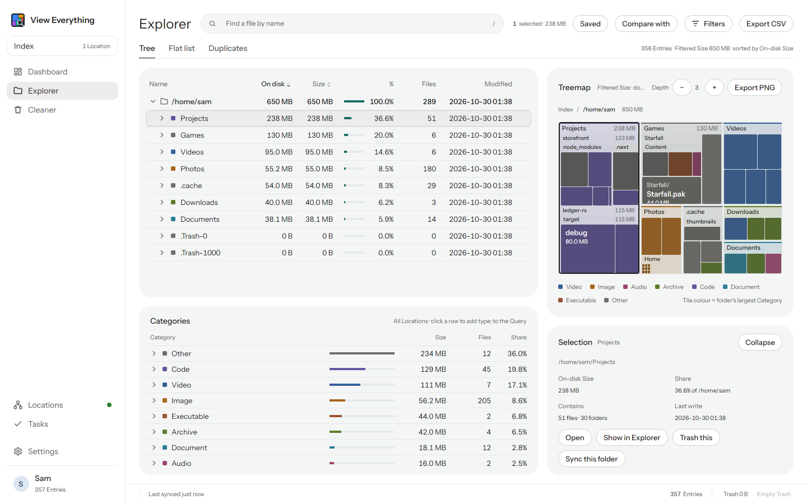
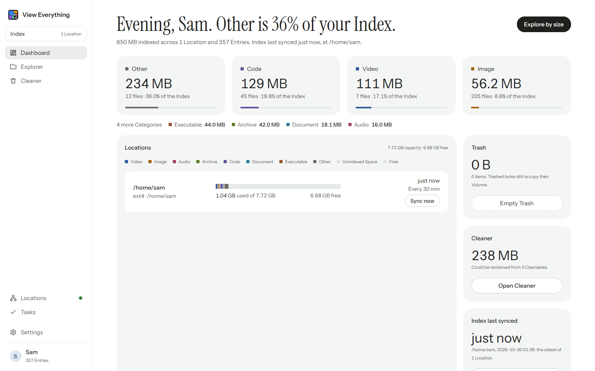
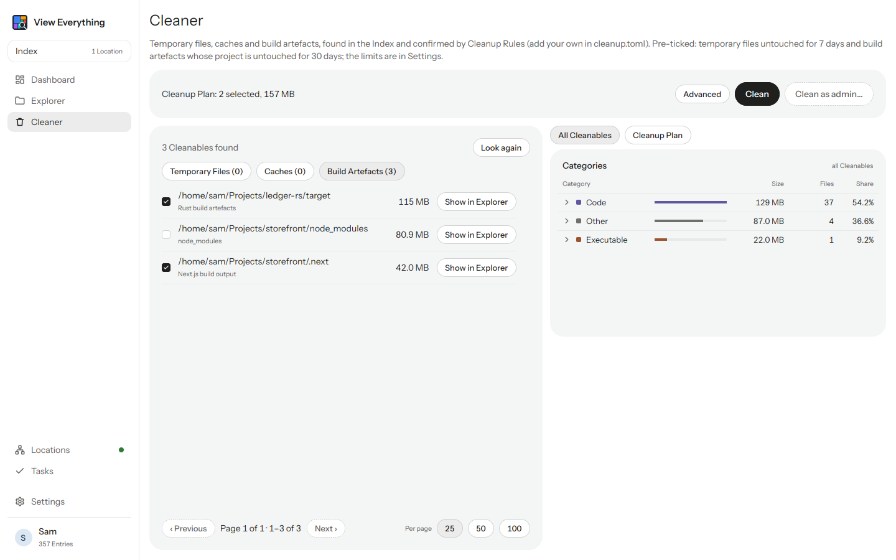
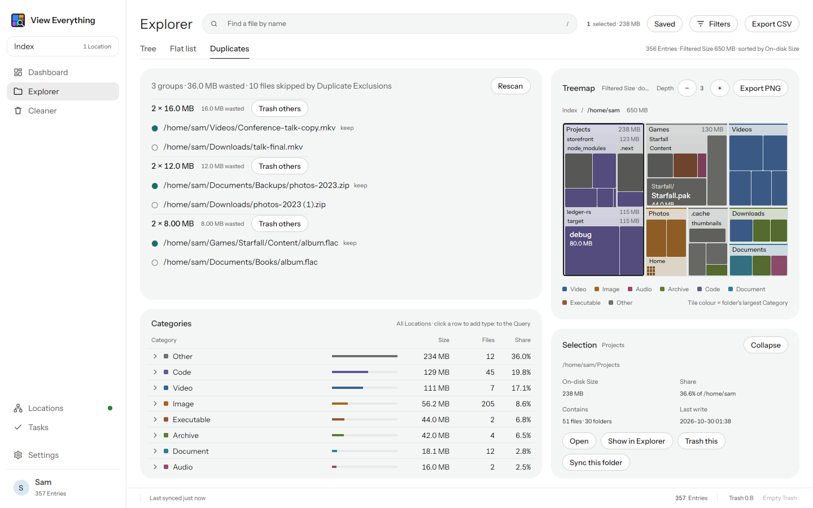

# View Everything

[](https://github.com/hawasman/view-everything/actions/workflows/ci.yml)
[](https://github.com/hawasman/view-everything/releases/latest)
[](#license)

**Find any file by name instantly, and see what is using your disk space.** A free, open-source desktop app for Linux, Windows and macOS.

[Install](#install) · [Features](#features) · [First run](#first-run) · [Query language](docs/guide/query-language.md) · [Command line](docs/guide/command-line.md) · [Docs](docs/README.md)

<picture>
  <source media="(prefers-color-scheme: dark)" srcset="docs/images/explorer-dark.png">
  
</picture>

It keeps one Index of every file on your Volumes, saved between runs, so searching and sizing never wait on a scan. It sends nothing anywhere: no telemetry and no account.

## Features

### Find
- **One Index** of every local Volume. Removable disks stay searchable as Offline Volumes after you unplug them. Mounted network shares are opt-in.
- **Remotes:** index SSH/SFTP, S3, FTP, WebDAV and Azure Blob storage, read-only. [More](docs/guide/remotes.md)
- **Query:** results as you type, with modifiers such as `ext:`, `size:>1gb`, `dm:yesterday`, `regex:` and `dupe:`. [More](docs/guide/query-language.md)
- **Saved Queries** for the searches you repeat.
- **Command line:** `ve find`, `ve top` and `ve export` read the same Index. [More](docs/guide/command-line.md)

### See
- **Dashboard:** space per Category, a capacity bar per Location, the largest and most recently modified files, and when each Location last synced.
- **Explorer:** a tree and a flat list beside a Treemap, all driven by one Query. Double-click any folder to zoom into it. Select several rows for the right-click menu: Open, Show in Explorer, Open terminal here, Copy path, Trash, Sync this folder and Export selection to CSV.
- **Treemap:** folders labelled with their name and size down to an adjustable Depth. Hover shows every enclosing folder. The **Selection panel** shows the selected item's size, share and contents, with actions.
- **Snapshots and Compare with:** a daily Snapshot of folder sizes, and a Change column showing what grew. [More](docs/guide/snapshots-and-export.md)
- **Export** to CSV or the Treemap to PNG. [More](docs/guide/snapshots-and-export.md#export)

### Clean
- **Cleaner:** temporary files, caches and build artefacts (`target/`, `node_modules`, `.next` …), each with its size and a safe default tick. Every item is checked again on disk before it is removed. Add your own Cleanup Rules in TOML. [More](docs/guide/cleanup-rules.md)
- **Duplicates:** files with identical content, confirmed by hash, largest waste first. Keep one, trash the others. [More](docs/guide/duplicates.md)
- **Trash** and Empty Trash, with confirmation.

### Stay current
- **Sync now** for everything, one Location or one folder; Catch-up at launch and a periodic Sync.
- **Live updates:** changes show within seconds on macOS, and on Linux with an opt-in helper. [More](docs/guide/live-updates-and-background.md)
- **Tasks:** every background job (Sync, Duplicate search, Clean, Compare …) shows its progress in the sidebar and can be cancelled.
- **Tray and start at login,** both off by default. [More](docs/guide/live-updates-and-background.md#background-tray-and-start-at-login)
- **Signed self-updates.** [More](docs/guide/updates-and-verification.md)

<table>
  <tr>
    <td width="50%"><picture><source media="(prefers-color-scheme: dark)" srcset="docs/images/dashboard-dark.png"></picture><br><sub>Dashboard</sub></td>
    <td width="50%"><picture><source media="(prefers-color-scheme: dark)" srcset="docs/images/cleaner-dark.png"></picture><br><sub>Cleaner</sub></td>
  </tr>
  <tr>
    <td width="50%"><picture><source media="(prefers-color-scheme: dark)" srcset="docs/images/duplicates-dark.png"></picture><br><sub>Duplicates</sub></td>
    <td width="50%"><picture><source media="(prefers-color-scheme: dark)" srcset="docs/images/tasks-dark.png"></picture><br><sub>Tasks</sub></td>
  </tr>
</table>

## Platform support

| | Linux | Windows | macOS |
| --- | :---: | :---: | :---: |
| Index, Query, Treemap, Cleaner, Duplicates | ✓ | ✓ | ✓ |
| Remotes | ✓ | ✓ | ✓ |
| [Live updates](docs/guide/live-updates-and-background.md#live-updates-by-platform) | opt-in, needs root | — (periodic Sync) | ✓ |
| [Fast whole-disk read](docs/guide/live-updates-and-background.md#windows-administrator-rights) | — | NTFS, as administrator | — |
| [Clean as admin](docs/guide/cleanup-rules.md#admin-only) | ✓ (`pkexec`) | shows the command | shows the command |
| [Tray and start at login](docs/guide/live-updates-and-background.md#background-tray-and-start-at-login) | ✓ (needs a tray host) | ✓ | ✓ |
| [Self-update](docs/guide/updates-and-verification.md#self-update) | AppImage | ✓ | ✓ |

## Install

Download the latest build from the [Releases](https://github.com/hawasman/view-everything/releases/latest) page:

| Platform | File |
| --- | --- |
| Windows | `view-everything-windows-x86_64.msi`, or the portable `.zip` |
| Linux | `view-everything-x86_64.AppImage` (`chmod +x`, then run it), or the AUR package |
| macOS (Apple Silicon and Intel) | `view-everything-macos-universal.dmg` |

- **macOS:** the app is not notarized. The first time, right-click it in Applications and choose **Open**.
- **Verify a download:** every file has a minisign signature. [How](docs/guide/updates-and-verification.md#verify-a-download)

## First run

1. **Open the app.** It builds the Index; the sidebar's Tasks row shows the progress. [More](docs/guide/live-updates-and-background.md)
2. **Search.** Type in the Explorer's Query box, for example `size:>1gb` or `ext:iso`. [More](docs/guide/query-language.md)
3. **Look at the Treemap.** Double-click a folder to zoom into it; click a tile to see it in the Selection panel.
4. **Open the Cleaner** to see what can be reclaimed. Nothing is removed until you press Clean. [More](docs/guide/cleanup-rules.md)

## Build from source

Needs a stable Rust toolchain. On Linux, GPUI also needs these development packages (Debian/Ubuntu names):

```sh
sudo apt-get install pkg-config libxkbcommon-dev libxkbcommon-x11-dev libwayland-dev \
  libxcb1-dev libvulkan-dev libegl1-mesa-dev libfontconfig1-dev libfreetype6-dev
```

```sh
cargo build --release
./target/release/view-everything
```

The workspace has `ve-core` (Index, Query, Filter), `ve-scan` (scanning Volumes and Remotes, watching mounts), `ve-app` (the GPUI app), `ve-cli` (`ve`) and `ve-fanotify` (the Linux Live updates helper). Packaging scripts are in [packaging](packaging): the AppImage and `.dmg` builds, the WiX source for the MSI, and an AUR `PKGBUILD`.

To contribute, enable the pre-commit hook once per clone. It runs the same checks as CI (rustfmt, clippy with warnings denied, and the tests):

```sh
git config core.hooksPath .githooks
```

The terms used in the app and the code are defined in [CONTEXT.md](CONTEXT.md), and design decisions are in [docs/adr](docs/adr). Maintainers: see [Releasing](docs/releasing.md).

## License

Licensed under either of [Apache License, Version 2.0](LICENSE-APACHE) or [MIT license](LICENSE-MIT) at your option. The bundled Instrument Sans and Instrument Serif fonts are under the SIL Open Font License (see `crates/ve-app/assets/fonts`).
